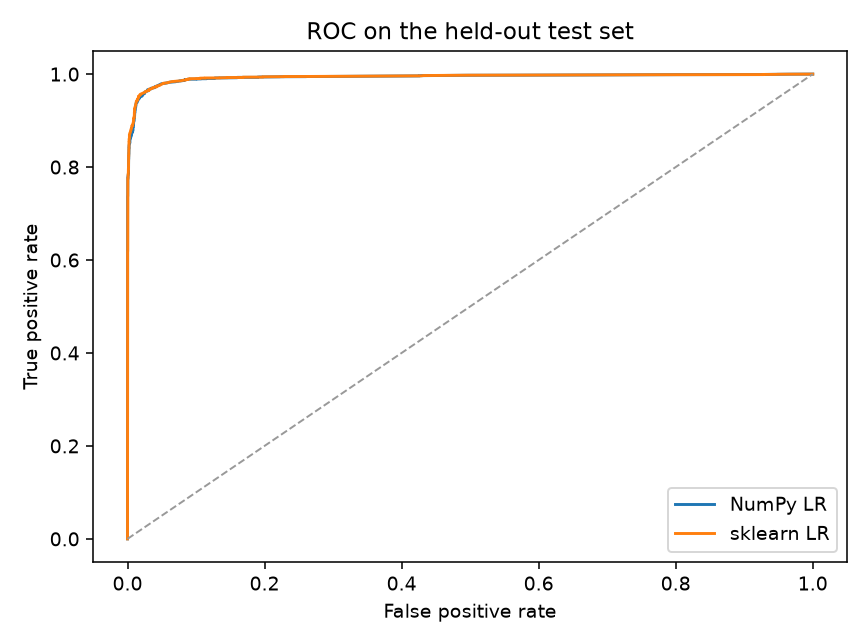
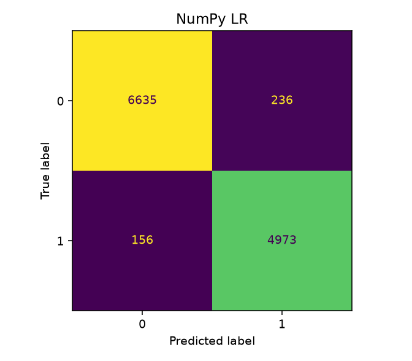

# PhishGuard

A small phishing URL detector I built to practice logistic regression. It only looks at the text of the URL: length, digit count, special characters, subdomains, whether the host is an IP, and a short list of suspicious words. The scheme is stripped first so length and punctuation cannot still encode http vs https.

Two models get those same features. One is logistic regression written from scratch in NumPy (sigmoid, cross-entropy, gradient descent, L2). The other is sklearn's `LogisticRegression`. The decision threshold is picked on a validation set by F1, then everything is scored on a held-out test set.

This is a course project, not a production filter.

## How to run

```bash
pip install -r requirements.txt
python -m phishguard train
python -m phishguard score 'https://example.com'
```

`train` downloads the PhiUSIIL CSV from UCI if it is not already in `data/`, fits both models, and writes `models/phishguard.npz` plus the charts. Tests:

```bash
pytest -q
```

## Live demo

Try it at https://huggingface.co/spaces/WasimSheikh/phishguard
Locally: `python app.py` after `pip install -r requirements.txt`.

## Results

80,000 URLs drawn from PhiUSIIL (seed 7), stratified 70/15/15. Positive class is phishing. Numbers below are on the 12,000-row test set.

I dropped the https/scheme flag because in this dataset every HTTP URL is phishing and every legitimate URL is HTTPS.

| model | threshold | precision | recall | F1 | ROC-AUC |
| --- | ---: | ---: | ---: | ---: | ---: |
| NumPy LR | 0.35 | 0.854 | 0.714 | 0.777 | 0.842 |
| sklearn LR | 0.25 | 0.838 | 0.741 | 0.787 | 0.844 |

The two fits stay close once they share the same scheme-free features.





## Data

[PhiUSIIL Phishing URL Dataset](https://archive.ics.uci.edu/dataset/967/phiusiil+phishing+url+dataset) (Prasad and Chandra, *Computers & Security*, 2024). Also on [Mendeley](https://data.mendeley.com/datasets/shwpxscxy2/1). License: [CC BY 4.0](https://creativecommons.org/licenses/by/4.0/).

The raw file is about 50MB and is not checked in. `python -m phishguard train` (or `python scripts/download_data.py`) pulls it from UCI and keeps `URL` plus a phishing label.

## Limitations

Lexical features only. No HTML, no DNS, no hosting or reputation signals. Digit counts are still very skewed toward phishing in this data, so the numbers above look stronger than they would on the live web. Do not use this as a real phishing filter.

Built after my DeepLearning.AI / Stanford Online course [Supervised Machine Learning: Regression and Classification](https://www.coursera.org/account/accomplishments/verify/VW0IAEFG1VKB).
